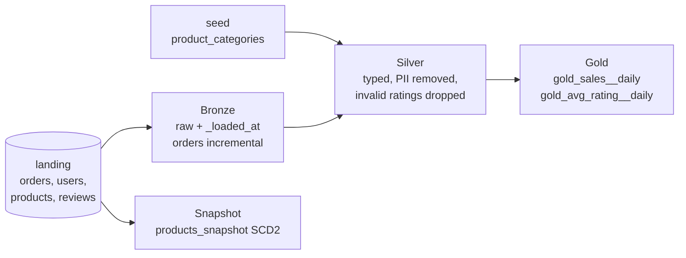

# 🛍️ dbt-Medallion-Ecommerce-Analytics

[](https://github.com/patrickokare/dbt-medallion-ecommerce-analytics/actions/workflows/ci.yml)

This project implements the **Medallion Architecture (Bronze → Silver → Gold)** using **dbt + Databricks** on an e-commerce dataset of Orders, Users, Products and Reviews.

Every pull request runs the whole project - models, snapshot, seeds, data tests and unit tests - against sample data in DuckDB, so changes are tested without a warehouse.

---

## 🧱 Medallion Architecture



| Layer | Purpose | Models |
|-------|---------|--------|
| **Bronze** | Raw copy of the landing tables plus a load timestamp. Orders load incrementally with a 3-day lookback for late rows. | `bronze_orders`, `bronze_users`, `bronze_products`, `bronze_reviews` |
| **Silver** | Cleaned and conformed: dates typed, order amount calculated, customer PII removed, product categories enriched from a seed. | `silver_orders`, `silver_users`, `silver_products`, `silver_reviews` |
| **Gold** | Business-ready aggregates for dashboards. | `gold_sales__daily`, `gold_avg_rating__daily` |
| **Snapshot** | SCD Type 2 history of the product catalogue (price / category / vendor changes). | `products_snapshot` |

---

## ✅ Data Quality

| Where | What is checked |
|---|---|
| Sources | unique / not-null ids, no negative quantities or prices, freshness (warn after 1 day, error after 3) |
| Silver | unique / not-null keys, orders → users and orders → products relationships, ratings between 1 and 5 |
| Gold | revenue never negative, one row per product per day, average rating in range |
| Reconciliation | `tests/singular/gold_revenue_matches_silver.sql` - Gold total revenue must equal Silver |
| Unit tests | order amount calculation, invalid ratings dropped, daily rating average |

All tests fail the build (`severity: error`).

---

## ⚙️ Tech Stack

- **dbt** (`dbt-databricks` for dev/prod, `dbt-duckdb` for CI)
- **Databricks** SQL warehouse + Unity Catalog, Delta Lake
- **dbt_utils** for generic tests
- **GitHub Actions** for CI/CD

---

## 🚀 How to Run

```bash
git clone https://github.com/patrickokare/dbt-medallion-ecommerce-analytics.git
cd dbt-medallion-ecommerce-analytics

# Locally, no warehouse needed - same as CI
pip install -r requirements-ci.txt
dbt deps
dbt build --target ci

# Against Databricks
pip install -r requirements.txt
export DATABRICKS_HOST=... DATABRICKS_HTTP_PATH=... DATABRICKS_TOKEN=...
dbt build --target dev
```

`profiles.yml` is in the repo and reads credentials from environment variables - nothing secret is committed.

---

## 🔁 CI/CD

| Trigger | What runs |
|---|---|
| Pull request / push | `dbt parse` for Databricks, then `dbt build` on DuckDB sample data, then a second run to exercise the incremental path |
| Push to `main` | Source freshness + `dbt build --target prod` on Databricks (when the `DATABRICKS_*` secrets are set) |

---

## 📁 Folder Structure

```bash
├── models/
│   ├── sources/        # landing source definitions + source tests
│   ├── bronze/
│   ├── silver/         # + unit tests
│   └── gold/           # + unit tests
├── snapshots/          # products_snapshot (SCD2)
├── seeds/              # product_categories.csv
├── macros/             # generate_schema_name, multiply_columns_and_round
├── tests/
│   ├── generic/        # assert_non_negative
│   └── singular/       # gold_revenue_matches_silver
├── data/sample/        # small fake dataset used by the CI target
├── profiles.yml        # dev / prod (Databricks) and ci (DuckDB)
└── .github/workflows/  # CI/CD
```

---

## 👨‍💻 Author

**Patrick Okare**  
Lead Data Engineer | Data Storyteller | Building Lakehouses with Purpose
